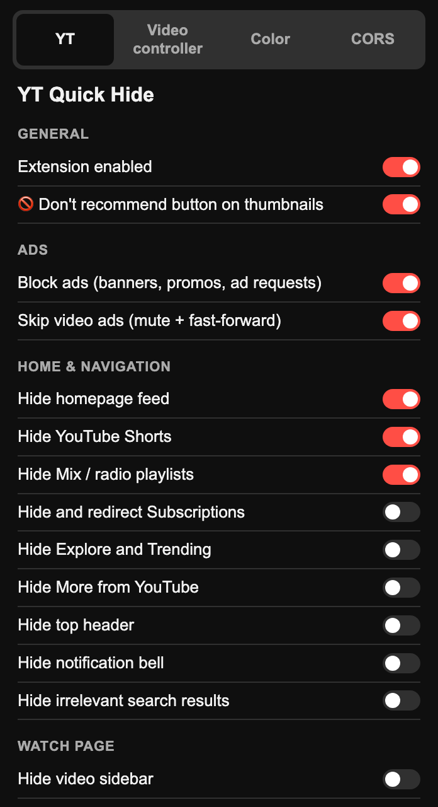
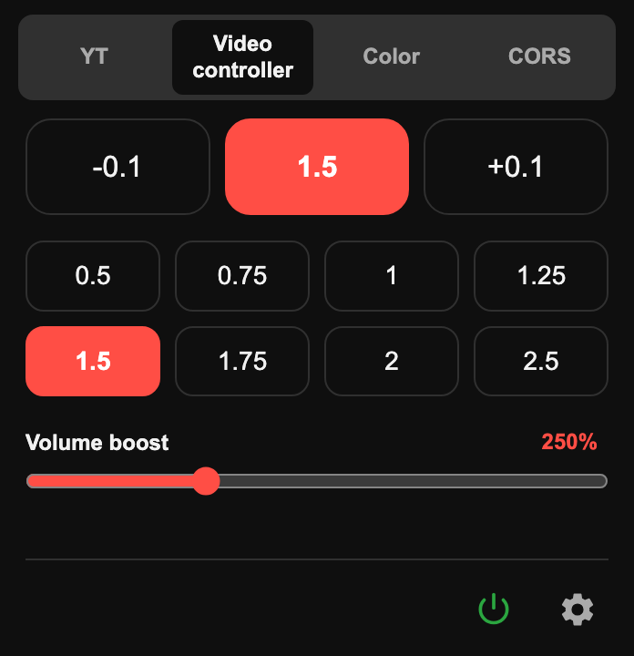
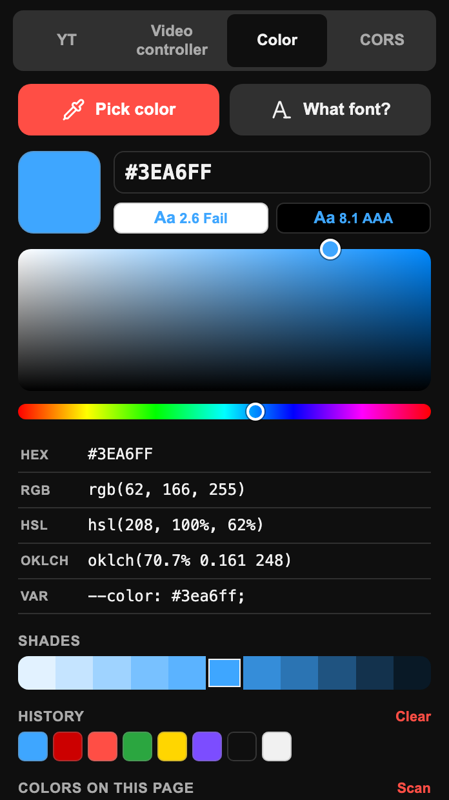
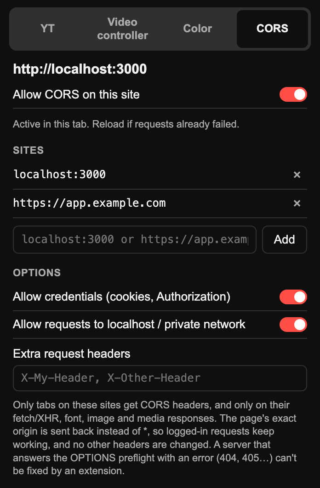

# Browser Kit

A lightweight Chrome extension (Manifest V3) that bundles a few everyday tools into one popup: a distraction-free YouTube, a speed and volume controller for any video, a color picker with a font inspector, and a per-site CORS switch for web development.

No accounts, no tracking, no build step. Everything runs locally and your settings sync through your Chrome profile.

<p align="center">
  
  
  
  
</p>

## Features

### 📺 YouTube
- **🚫 One-click hide**: a button on every thumbnail that picks "Don't recommend channel" (or "Not interested") for you.
- **Dislike counts**: brings back the dislike count on videos and Shorts, using the [Return YouTube Dislike](https://returnyoutubedislike.com) API.
- **Ad blocking**: blocks ad requests and banners, and mutes and fast-forwards video ads.
- **Hide distractions**: switches for the home feed, Shorts, Mixes, comments, related videos, live chat, end screens, autoplay and more.

### ⏩ Video controller (works on every site)
- Change playback speed for any `<video>` or `<audio>`, with presets from 0.5× to 2.5×.
- Boost volume up to 600%.
- **Pop out** any video into a picture-in-picture window.
- **A–B loop**: repeat a chosen section, handy for music practice or tutorials.
- Keyboard shortcuts:

  | Key | Action |
  | --- | --- |
  | `S` / `D` | Slower / faster |
  | `R` | Reset to 1× |
  | `G` | Toggle 1.8× |
  | `Z` / `X` | Back / forward 10s |
  | `P` | Picture-in-picture on / off |
  | `A` | A–B loop: set start, set end, clear |
  | `V` | Show / hide the speed overlay |

### 🎨 Color
- Eyedropper to pick any color on the page.
- Copy as HEX, RGB, HSL, OKLCH or a CSS variable.
- Contrast check against white and black, shades, history, and a scan of the colors used on the page.
- **What font?** Hover any text to see its font, size and weight. Click to pin details and copy the CSS.

### 🌐 CORS
- Turn CORS on for the sites you choose, like `localhost:3000`.
- Sends back the page's exact origin instead of `*`, so cookies and `Authorization` headers keep working.
- Only affects tabs on those sites. A **CORS** badge shows when it is on.

### 🔒 Focus (site blocker)
- Block any site, and its subdomains, from the popup or with one click on the current tab.
- A blocked site opens a page that asks you to type *"i am a looser and continue to be"* (no pasting). That unlocks the site for 10 minutes.
- After 10 minutes the site is blocked again, and tabs still on it go back to the blocked page.
- A site can only be removed from the list while it is unlocked.

## Installation

1. Clone or [download](https://github.com/Muhsin-42/browser-kit/archive/refs/heads/main.zip) this repository.
   ```bash
   git clone https://github.com/Muhsin-42/browser-kit.git
   ```
2. Open `chrome://extensions` and turn on **Developer mode**.
3. Click **Load unpacked** and select the project folder.
4. Pin the extension and click its icon to open the popup.

Requires Chrome 121 or newer (also works in Edge, Brave and other Chromium browsers).

### Firefox

1. Open `about:debugging#/runtime/this-firefox`.
2. Click **Load Temporary Add-on…** and select `manifest.json` in the project folder.

Requires Firefox 140 or newer. Firefox has no picture-in-picture API for extensions, so the "Pop out" button is hidden there; use Firefox's own PiP toggle on the video instead.

## Project structure

| File | Purpose |
| --- | --- |
| `manifest.json` | Extension manifest |
| `popup.html`, `popup.css`, `popup.js` | The popup and its tabs |
| `features.js`, `settings.js`, `hide.css` | YouTube hide switches |
| `dislikes.js` | Dislike counts (Return YouTube Dislike) |
| `content.js`, `styles.css` | One-click "Don't recommend" button |
| `rules.json`, `background.js` | Ad-request blocking and CORS rules |
| `speed.js`, `speed-main.js` | Speed controller and volume boost |
| `popup-color.js`, `picker.js`, `fontinspect.js` | Color picker and font inspector |
| `cors.js` | Shared CORS settings |
| `blocker.js` | Shared site blocker settings and unlock phrase |
| `blocked.html`, `blocked.js` | Page shown for blocked sites, with the unlock phrase |

## Permissions

| Permission | Why |
| --- | --- |
| `storage` | Save your settings |
| `declarativeNetRequest` | Block ad requests, add CORS headers and redirect blocked sites |
| `alarms` | Block a site again 10 minutes after you unlock it |
| `activeTab`, `scripting` | Run the color picker and font inspector on the current tab |
| `<all_urls>` | Speed controller and CORS work on any site |
